# Bandlantern

A software-defined radio lab bench, built to learn DSP and radio protocols from their specs. Each
curriculum module adds a demodulator or decoder to the bench and ends with a devlog post.

- **How it's built:** I write the DSP and decoders myself, from specs and papers (clean-room,
  ADR-004). The plumbing (UI, protocol, build, CI) is AI-assisted; commits made with Claude carry
  a `Co-Authored-By` trailer. See ADR-001 and ADR-002.
- **Curriculum:** [docs/learning/CURRICULUM.md](docs/learning/CURRICULUM.md)
- **Devlog:** `site/` (published at https://bandlantern.com)
- **Hardware:** an RTL-SDR dongle (NESDR SMArt v5), optionally with a Ham It Up upconverter for HF. Receive only.

## Structure

How data flows through the bench today, and who wrote each block. Blue blocks are AI-built
plumbing; orange blocks are mine; dashed blocks are mine and not written yet. Kept up to date as
modules land.

```mermaid
flowchart LR
  subgraph SRC[Sources]
    direction TB
    S1[File playback<br/>SigMF / WAV captures<br/>cu8, cs16, cf32]:::ai
    S2[Synthetic IQ<br/>tones, sweeps<br/>tools/py]:::ai
  end

  subgraph ENG[Engine - headless C++]
    direction TB
    RD[IQ file readers<br/>parse header, convert to cf32,<br/>loop or stop at EOF]:::ai
    RT[Reader thread + pacing<br/>real-time playback rate]:::todo
    RING[SPSC ring<br/>lock-free handoff, cf32 blocks]:::ai
    SPEC[Spectrum block<br/>window, FFT, dBFS scaling,<br/>averaging, overlap]:::todo
    CTL[Playback controller<br/>play / stop / FFT size,<br/>validates every command]:::ai
    SRV[API server<br/>loopback WebSocket + HTTP,<br/>token, per-client row queues]:::ai
  end

  subgraph UI[UI - browser, TypeScript]
    direction TB
    CLI[Client<br/>decode binary frames + JSON events]:::ai
    BUS[Row bus<br/>fan out spectrum rows]:::ai
    WF[Waterfall<br/>WebGL2, colormaps, auto range]:::ai
    SP[Spectrum trace]:::ai
    PNL[Source + status panels<br/>LED readouts]:::ai
  end

  subgraph KEY[Legend]
    direction TB
    K1[Built by AI - Claude]:::ai
    K2[Written by me]:::me
    K3[Mine, not written yet]:::todo
  end

  S2 -- writes --> S1
  S1 --> RD
  RD -- cf32 samples --> RT
  RT --> RING
  RING -- cf32 blocks --> SPEC
  SPEC -- dBFS rows --> CTL
  CTL -- rows --> SRV
  SRV -- binary spectrum frames --> CLI
  SRV -- JSON events --> CLI
  CLI -- JSON commands --> SRV
  SRV -- commands --> CTL
  CLI --> BUS
  BUS --> WF
  BUS --> SP
  CLI -- source + status --> PNL

  classDef ai fill:#dbe7f3,stroke:#3b6a99,color:#10263d
  classDef me fill:#f6dfd3,stroke:#b5522a,color:#3d1a0a,stroke-width:2px
  classDef todo fill:#ffffff,stroke:#b5522a,color:#3d1a0a,stroke-width:2px,stroke-dasharray:6 4
```



## Layout

| Path | Contents |
|---|---|
| `engine/` | C++20 headless engine (DSP, sources, buffers, decoders, API server) |
| `site/` | Devlog (Astro) |
| `tools/` | Dev scripts: env check, time tracker |
| `docs/` | ADRs, curriculum, dev workflow, legal |

More directories appear as the modules need them.

## Build (macOS / Linux)

Needs CMake ≥ 3.25, Ninja, a C++20 compiler, and vcpkg (`VCPKG_ROOT` set).

```bash
cmake --preset macos-debug
cmake --build --preset macos-debug
ctest --preset macos-debug
```

Other presets: `macos-asan`, `macos-tsan`, `linux-debug`, `linux-asan`, `linux-tsan`, `win-msvc`.

## License

Code: MIT ([LICENSE](LICENSE)). Devlog text: CC BY 4.0.
