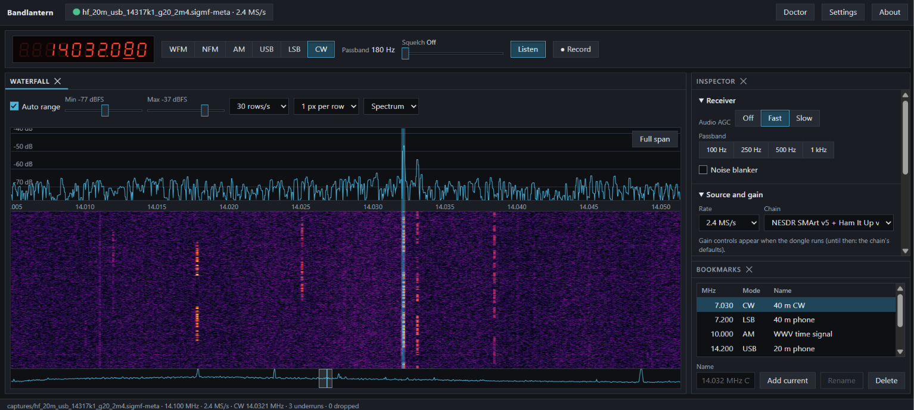

## What I built, and how
I've been working on a new SDR software application for the past week or so and I've made incredible
progress. Below is a screenshot of it in action:

It was built from scratch with fully custom DSP pipelines for analog mode demodulation and audio
and a web-based interface. How did I make this so fast? AI. Claude Code to be exact. It can print
code faster than I can read it. And I thought, "you know what? how about i let Claude do its thing
and just get out of the way." So I took a backseat on my own project and directed Claude to build
this and do that and by the time I had a working alpha build of the software, I realized I didn't
really know how it worked. But it was all justified as long as the end result was a quality product
I could sell.

## What I found out
Once I had my alpha build I started using it to peruse the amateur radio bands and one conversation
caught my attention. It was a ham raving about this new radio software he was using! I couldn't
quite confirm which software he was talking about, but he went on and on about how many cool
features it had and how the developers were so responsive. I searched online for what cool software
this could be and if it had any ideas I could use for my own software, but what I found was a vast
multitude of new SDR applications being released in 2026. What's more, they were AI-assisted, had
dozens of contributors, and were open source! How can I compete with that! So I went back to the
drawing board. What to do with my little SDR program experiment?

## What I'm doing instead
If I couldn't realistically make money from selling this software, then what good is it? I then
thought back to the long-forgotten second reason I began making this thing in the first place: I
wanted to learn more about radio modulation modes by building the demodulators myself. I had
abandoned that idea before since Claude could spit out a fully working and unit-tested demodulator
in half an hour, but if velocity is no longer of concern, I could start again. So that's what I'm
doing, the project is being rewritten from scratch. No longer is it a closed-source proprietary
application, it is now an MIT licensed open source display of my own attempts to learn radio through
programming.

## The rules
That's not to say I won't use AI at all, rather I'm going to use it differently. Instead of
optimizing for velocity, I'm optimizing for learning. The AI will handle all the boring stuff: the
interface, plumbing, CI, unit tests, etc. Meanwhile I will focus purely on the interesting DSP. I'll
write DSP modules by hand, based on the written specs for the relevant protocols. If there's
something I don't know how to do, the AI will teach me, not write it for me. I'll try to make it
very clear through the commit history and through disclosures what parts are written by AI and what
parts are written by me, so outsiders can discern how much I truly know about what I'm building.
It's fun, it helps me learn, and it may prove to be a useful showcase of my skills to prospective
employers.

## What's next
The first thing on the list starts all the way back at square one. I need to take the raw data from
the SDR and use FFTs to display the data on a waterfall. It should be simple and I've written
similar code before, but I will learn at least one thing: how to do such a thing in real time.
Every module going forward will need to operate with a real-time data stream, so this waterfall
serves as a good introduction to that.

## AI-use note
Claude generated the outline and section titles for this post, but all the words are my own.
